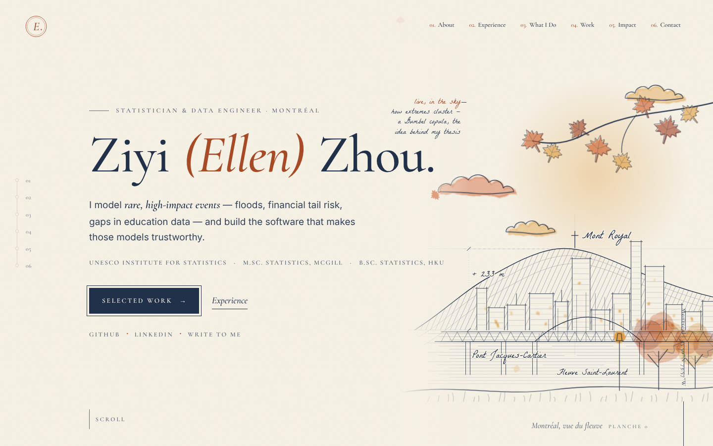
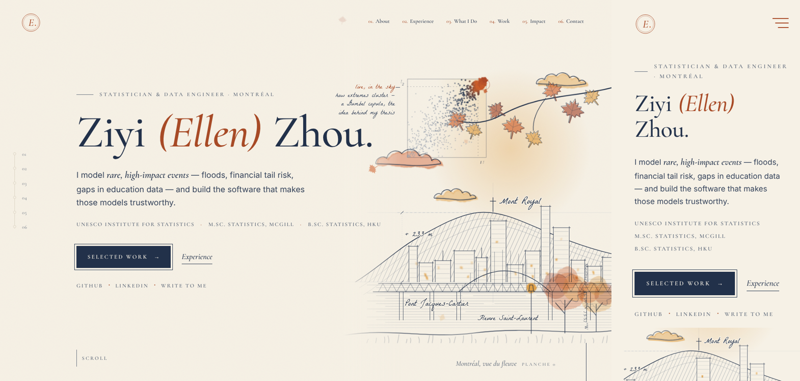
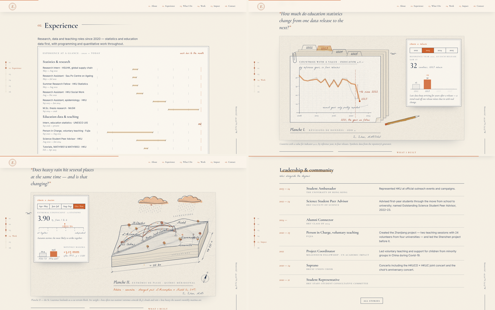
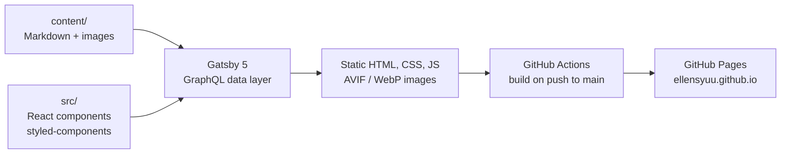

<div align="center">


# Ziyi (Ellen) Zhou — Personal Website

**Statistician & data engineer · education data and official statistics · extreme value theory**

[**ellensyuu.github.io →**](https://ellensyuu.github.io)

[](https://github.com/EllenSyuu/EllenSyuu.github.io/actions/workflows/deploy.yml)


[](LICENSE)

<br />



</div>

## Overview

A portfolio ordered for a reader deciding quickly — who, then experience, then evidence:

| # | Chapter | What it answers |
| --- | --- | --- |
| — | **Cover** | Who I am in one sentence, with GitHub, LinkedIn and contact one click away |
| — | **By the numbers** | Languages, research roles and a few concrete figures |
| 01 | **About** | The short version and the path: HKU → McGill → UNESCO UIS |
| 02 | **Experience** | A month-exact timeline of every role since 2020, then the details per role |
| 03 | **What I Do** | Three threads — extremes & tail risk, trustworthy modelling software, statistics for the public good — each linked to its evidence |
| 04 | **Work** | Four case studies, each as an illustrated plate with its key results and code: [SDG 4 Data Revision Tracker](https://github.com/EllenSyuu/SDG), [covarchimax](https://github.com/EllenSyuu/SAC-thesis-2026), VVI, TailFM |
| 05 | **Beyond the Code** | Stories with their own pages, and a ledger of leadership and community roles |
| 06 | **Contact** | A short note form that lands in my inbox |

Personal projects are labelled as independent work on synthetic data; none is an official product of an institution I have worked for. A **Notes** section renders Markdown with LaTeX (KaTeX) for technical writing.

<div align="center">
  
  <br /><br />
  
</div>

## Design & motion

An **atelier engineering drawing**: blue-black ink and graphite on warm paper, construction lines running past the corners, dimension lines and hand-lettered labels, with orange watercolour kept for autumn things (maples, clouds) and for the numbers that matter. Every motion either draws the plate or explains the data.

- **Cover plate.** Montréal from the river — Mont Royal in contour and hatching, a skyline in architect's elevation, the Jacques-Cartier truss, ruled water, maples and a branch in watercolour. On wide screens the plate inks itself on load; on phones it appears finished. A hairline inset keeps the live **Gumbel-copula** field (Marshall–Olkin algorithm; positive-stable frailty via Chambers–Mallows–Stuck), whose joint extremes turn warm. [`hero.js`](src/components/sections/hero.js) · [`tail-field.js`](src/components/tail-field.js)
- **Case studies as plates.** Each featured project is drawn from its own published numbers, not a pasted chart: an axonometric terrain block of southern Québec whose clouds and dependence arcs follow the season; Victoria Harbour in elevation with the 2022 Omicron waves and a ledger of sufficient statistics; heavy-tailed ridges feeding a two-pathway network; four data releases stacked as archive sheets. Plates draw in once when they come into view and pause off screen. [`src/components/cases/`](src/components/cases)
- **Highlighter.** Titles get a watercolour brush stroke with a pencil underline as they scroll into view. [`mark-observer.js`](src/components/mark-observer.js)
- **Experience timeline.** Every role on one ruled 2020-to-today axis, grouped into three strands. [`experience-timeline.js`](src/components/experience-timeline.js)
- **Margins.** A small maple leaf follows the mouse; a few leaves drift down over the cover only; now and then an ink gull or pigeon crosses the page. [`cursor-trail.js`](src/components/cursor-trail.js) · [`bird-flyover.js`](src/components/bird-flyover.js)
- **Contact form.** Name, email and message, sent to my inbox through [Web3Forms](https://web3forms.com) (a static site cannot send mail itself), with a honeypot against bots and a thank-you state. [`contact.js`](src/components/sections/contact.js)
- **Typography.** Cormorant Garamond for display and small-caps labels, Inter for text, La Belle Aurore for hand-lettered notes, JetBrains Mono for code — self-hosted, preloaded, with a metric-matched fallback for Inter.
- **Considerate by default.** All motion respects `prefers-reduced-motion`. On phones the cover is shown finished, watercolour edges and the paper grain are skipped, and the copula canvas is not loaded.

## Quality

Lighthouse 12 on the production build (October 2026). Mobile scores vary from run to run under simulated slow 4G and a 4× slower CPU:

| Page | Performance | Accessibility |
| --- | :---: | :---: |
| Home (desktop) | **93–96** | **100** |
| Home (mobile) | 52–78, typically ~72 | **100** |

Layout shift is near zero on both (CLS ≤ 0.006).

- **Readable by default.** Text contrast at WCAG AA or better, a skip link, keyboard-navigable tabs and reduced-motion support.
- **Static and fast.** Every page is pre-rendered, so crawlers and readers without JavaScript see the real numbers; images are responsive AVIF/WebP.
- **No data in the repo.** Project art is drawn from published or synthetic results; nothing restricted is committed.

## Architecture



Content and presentation are separate: every entry on the site is a Markdown file with front matter, so updating the site never requires touching a component.

| Section | Source | Notes |
| --- | --- | --- |
| Hero, numbers, What I Do | `src/components/sections/hero.js`, `stats.js`, `focus.js` | Positioning line, figures and the three threads |
| About & path | `src/components/sections/about.js` | Bio and timeline |
| Experience | `content/jobs/<role>/index.md` | Tabs sorted by `date`, newest first |
| Featured work | `content/featured/<project>/index.md` + `cover.jpg` | Ordered by `date` |
| Other projects & `/archive` | `content/projects/*.md` | `showInProjects: false` keeps an entry in the archive only |
| Beyond the Code & `/impact` | `content/impact/<story>/index.md` + `cover.jpg` | Ordered by `order`; first three appear on the home page |
| Notes & `/notes` | `content/posts/<post>/index.md` | `draft: true` posts render only in development |
| Name, links, chapters | `src/config.js` | Navigation order = storyline = chapter map; set `hasPortrait: true` after adding `src/images/me.jpg` |
| Colours & typography | `src/styles/variables.js` | One accent variable re-themes the site |

## Repository structure

```
├── .github/workflows/deploy.yml   build and publish to GitHub Pages
├── content/                       all site content (Markdown + images)
│   ├── featured/  impact/  jobs/  posts/  projects/
├── docs/                          README images
├── scripts/readme-images/         reproducible screenshots for this README
├── src/
│   ├── components/                layout, sections, cases (plates), tail-field, experience-timeline, bird-flyover, chapter-map
│   ├── pages/                     /, /archive, /impact, /notes, 404
│   ├── templates/                 notes and story pages (KaTeX), tag pages
│   ├── styles/                    theme variables, global styles, mixins
│   ├── hooks/  utils/  images/
│   └── config.js
├── static/                        files served as-is (og image, résumé)
└── gatsby-config.js · gatsby-node.js · package.json
```

## Development

Requires Node 20 (see `.nvmrc`).

```bash
npm ci
npm start                    # dev server at http://localhost:8000, drafts included
npm run build && npm run serve   # production build at http://localhost:9000
```

To refresh the README images after a change (Python with Playwright):

```bash
python scripts/readme-images/capture.py /tmp/shots http://localhost:9000
python scripts/readme-images/compose.py /tmp/shots docs
```

## Deployment

Every push to `main` runs [`deploy.yml`](.github/workflows/deploy.yml): install with `npm ci`, build with path prefixes worked out from the repository name, and publish to GitHub Pages. The same workflow serves `EllenSyuu.github.io` at the root and any other repository name under `/<repo>/`.

## Credits & licence

Design and original code by [Brittany Chiang](https://brittanychiang.com) ([v4](https://github.com/bchiang7/v4)), used under the MIT licence and adapted here: upgraded to Gatsby 5 and React 18, redrawn as an atelier engineering plate with a new type system and motion layer, and extended with the Beyond the Code column, LaTeX notes and an automated Pages deployment.

Code is MIT-licensed (see [LICENSE](LICENSE)). Text and images in `content/`, `src/images/` and `static/` are personal and not covered by the licence. Fonts (Cormorant Garamond, Inter, La Belle Aurore, JetBrains Mono) are under the SIL Open Font License.
