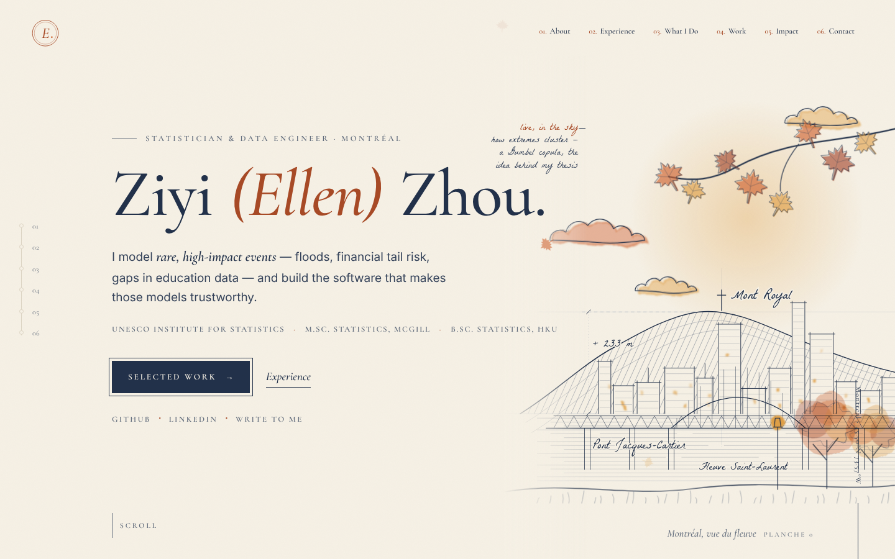
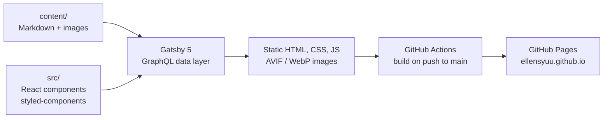

<div align="center">


# Ziyi (Ellen) Zhou — Personal Website

**Statistician & data engineer · education data and official statistics · extreme value theory**

[**ellensyuu.github.io →**](https://ellensyuu.github.io)

[](https://github.com/EllenSyuu/EllenSyuu.github.io/actions/workflows/deploy.yml)


[](LICENSE)

<br />



</div>

## Overview

The cover — a masthead over a painting of Montréal at dusk — sets the art direction; everything below it is laid out as pages of the same publication, on the cover's margins, palette and type.

| Section | What it answers |
| --- | --- |
| **Cover** | Who I am, with GitHub, LinkedIn and contact one click away |
| **About** | A short biography, two photographs and a profile column: HKU → McGill → UNESCO UIS, languages |
| **Experience** | A month-exact range chart of every role since 2020, then each principal role as a dated entry |
| **What I do** | Three questions that run through the work, each pointed at its evidence |
| **Selected work** | Four short research articles — question, why it matters, method, evidence as figures, code: [SDG 4 Data Revision Tracker](https://github.com/EllenSyuu/SDG), [covarchimax](https://github.com/EllenSyuu/SAC-thesis-2026), [VVI](https://github.com/EllenSyuu/VVI), [selection-valid tail-index inference](https://github.com/EllenSyuu/tailfm-union-band) |
| **Other projects** | A grouped index: research & methods, software & tools, study notebooks |
| **Beyond the code** | Three stories with their own pages, and a ledger of leadership and community roles |
| **Contact** | A short note form that lands in my inbox |

Personal projects are labelled as independent work on synthetic data; none is an official product of an institution I have worked for. A **Notes** section renders Markdown with LaTeX (KaTeX) for technical writing.

## Design

An **editorial scientific atlas**, derived from the cover rather than added to it.

- **One system.** Paper `#f6f0e4`, ink `#14213a`, vermilion `#c8431f` for emphasis, gold `#e0ad4a`, and the cover's river, hill and haze blues for data. Bodoni Moda for headings and decks, Inter for text and figures. Every section opens with the cover's double-ruled issue bar and sits on the cover's page margins. [`editorial.js`](src/components/editorial.js)
- **Figures, not decoration.** Each case study is told with figures drawn from the project's own published numbers, set like a journal: numbered captions with their source, direct labels, no chart junk. Charts are drawn at their real width, so text stays legible on a phone. [`src/components/figures/`](src/components/figures)
  - SDG 4: one indicator as published in four releases (synthetic data).
  - covarchimax: two small maps of southern Québec (Natural Earth base map) with station pairs weighted by tail dependence in June–July and October–November, and the six-station extremal coefficient by season with bootstrap intervals.
  - VVI: a forest plot of recovered against planted hazard ratios, and the build-and-fit benchmark.
  - Tail-index inference: union and first-order bands on the Danish fire-insurance data, and the pre-registered coverage benchmark — including the four settings where the method fails.
- **Photographs** are my own; no stock images or generated illustrations below the cover.
- **Quiet by default.** Motion is kept to the cover; the sections below do not animate.

## Quality

Lighthouse 12 on the production build (October 2026). Mobile scores vary from run to run under simulated slow 4G and a 4× slower CPU:

| Page | Performance | Accessibility |
| --- | :---: | :---: |
| Home (desktop) | **93–96** | **100** |
| Home (mobile) | 52–78, typically ~72 | **100** |

Layout shift is near zero on both (CLS ≤ 0.006).

- **Readable by default.** Text contrast at WCAG AA or better, a skip link, keyboard-navigable tabs and reduced-motion support.
- **Static and fast.** Every page is pre-rendered, so crawlers and readers without JavaScript see the real numbers; images are responsive AVIF/WebP.
- **No data in the repo.** Project art is drawn from published or synthetic results; nothing restricted is committed.

## Architecture



Content and presentation are separate: every entry on the site is a Markdown file with front matter, so updating the site never requires touching a component.

| Section | Source | Notes |
| --- | --- | --- |
| Hero, numbers, What I Do | `src/components/sections/hero.js`, `stats.js`, `focus.js` | Positioning line, figures and the three threads |
| About & path | `src/components/sections/about.js` | Bio and timeline |
| Experience | `content/jobs/<role>/index.md` | Tabs sorted by `date`, newest first |
| Featured work | `content/featured/<project>/index.md` + `cover.jpg` | Ordered by `date` |
| Other projects & `/archive` | `content/projects/*.md` | `showInProjects: false` keeps an entry in the archive only |
| Beyond the Code & `/impact` | `content/impact/<story>/index.md` + `cover.jpg` | Ordered by `order`; first three appear on the home page |
| Notes & `/notes` | `content/posts/<post>/index.md` | `draft: true` posts render only in development |
| Name, links, chapters | `src/config.js` | Navigation order = storyline = chapter map; set `hasPortrait: true` after adding `src/images/me.jpg` |
| Colours & typography | `src/styles/variables.js` | One accent variable re-themes the site |

## Repository structure

```
├── .github/workflows/deploy.yml   build and publish to GitHub Pages
├── content/                       all site content (Markdown + images)
│   ├── featured/  impact/  jobs/  posts/  projects/
├── docs/                          README images; redesign/ holds the redesign record
├── scripts/readme-images/         reproducible screenshots for this README
├── src/
│   ├── components/                layout, sections, editorial (design system), figures, experience-timeline
│   ├── pages/                     /, /archive, /impact, /notes, 404
│   ├── templates/                 notes and story pages (KaTeX), tag pages
│   ├── styles/                    theme variables, global styles, mixins
│   ├── hooks/  utils/  images/
│   └── config.js
├── static/                        files served as-is (og image, résumé)
└── gatsby-config.js · gatsby-node.js · package.json
```

## Development

Requires Node 20 (see `.nvmrc`).

```bash
npm ci
npm start                    # dev server at http://localhost:8000, drafts included
npm run build && npm run serve   # production build at http://localhost:9000
```

To refresh the README images after a change (Python with Playwright):

```bash
python scripts/readme-images/capture.py /tmp/shots http://localhost:9000
python scripts/readme-images/compose.py /tmp/shots docs
```

## Deployment

Every push to `main` runs [`deploy.yml`](.github/workflows/deploy.yml): install with `npm ci`, build with path prefixes worked out from the repository name, and publish to GitHub Pages. The same workflow serves `EllenSyuu.github.io` at the root and any other repository name under `/<repo>/`.

## Credits & licence

The code started from [Brittany Chiang](https://brittanychiang.com)'s [v4](https://github.com/bchiang7/v4), used under the MIT licence, upgraded to Gatsby 5 and React 18 and since redesigned. Base-map data for the Québec figure: [Natural Earth](https://www.naturalearthdata.com/) (public domain).

Code is MIT-licensed (see [LICENSE](LICENSE)). Text and images in `content/`, `src/images/` and `static/` are personal and not covered by the licence. Fonts (Bodoni Moda, Inter, JetBrains Mono and others under `@fontsource`) are under the SIL Open Font License.
